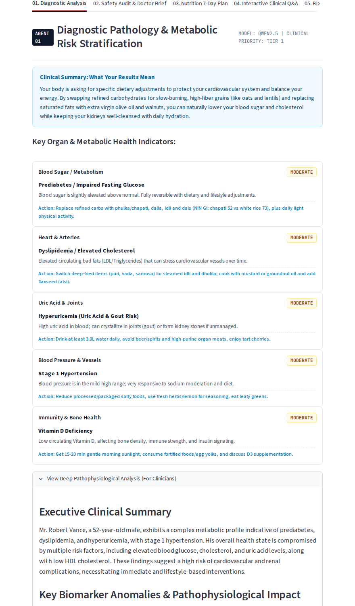
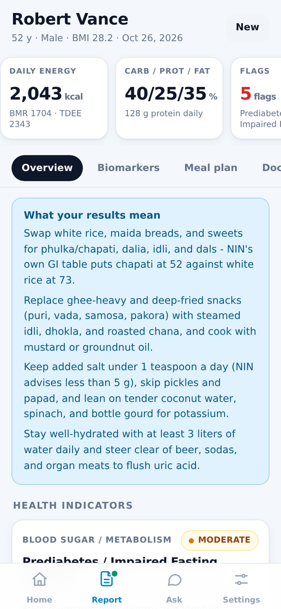
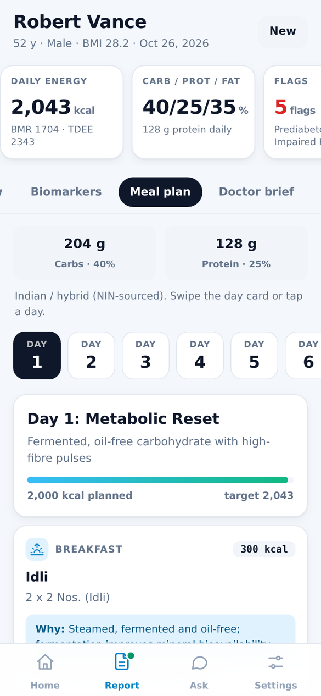
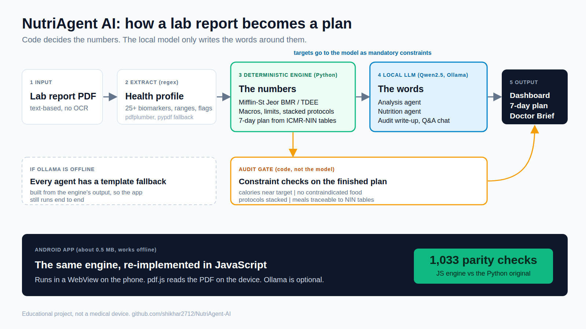
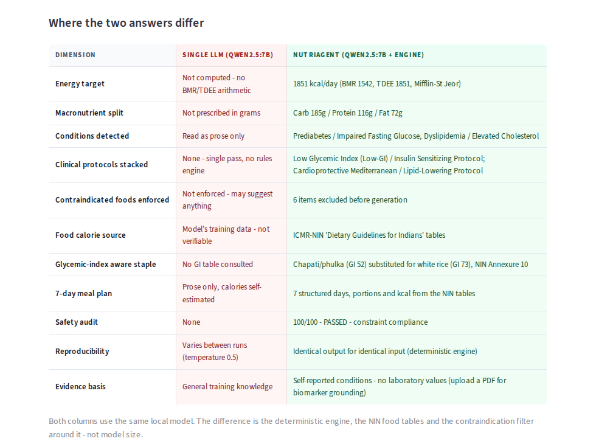
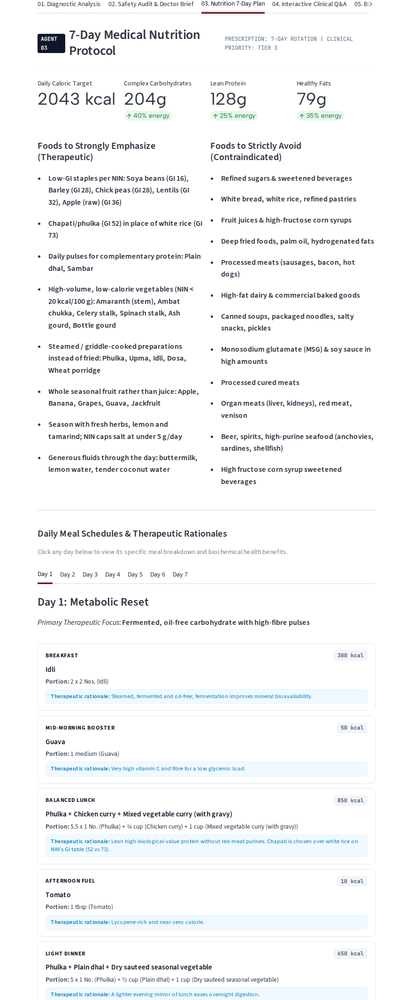
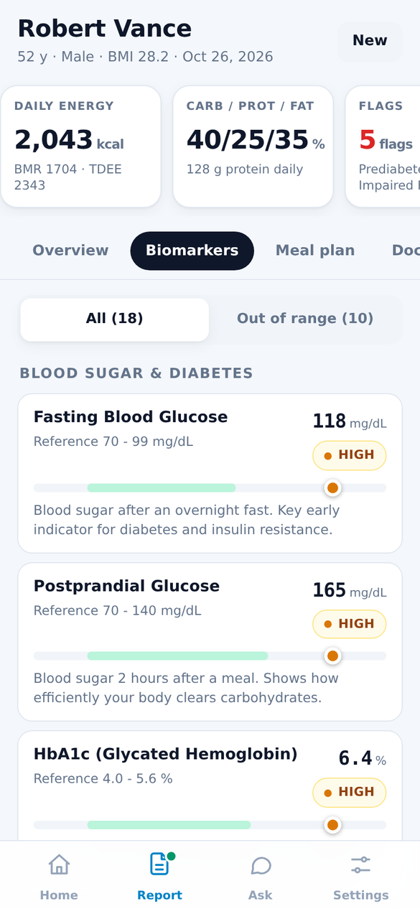
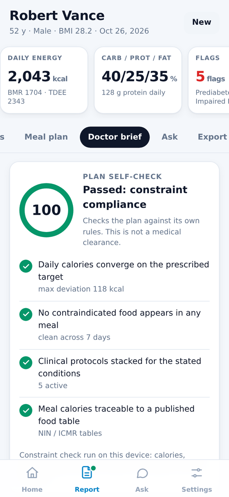
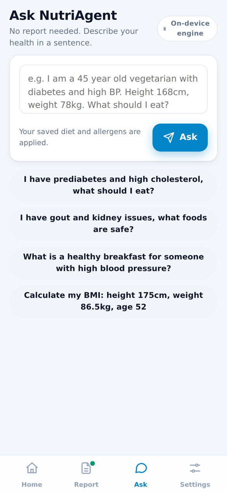

# NutriAgent AI

I built NutriAgent to turn a blood-test PDF into something a person can actually act on: which values are out of range, how many calories and how much protein, carbs and fat they need, and a 7-day Indian meal plan that respects their results, followed by a short memo they can hand to a doctor.

It runs on my own machine. The numbers come from a deterministic rules engine, and a local Qwen2.5 model (through Ollama) only writes the explanations around them. Nothing is sent to a cloud API. There is also a standalone Android app that does the whole thing on the phone.

> **Educational project, not a medical device.** It gives general nutrition information worked out from the values in a report. It does not diagnose or treat anything. Anything it produces should be reviewed by a doctor or registered dietitian before you act on it.

| Web app (Streamlit) | Android app |
| :---: | :---: |
|  |   |

---

## How it works

<p align="center">
  
</p>

```
Lab report (PDF)
   -> Extraction            pdfplumber, pypdf as fallback
   -> Health profile        demographics, 25+ biomarkers with reference ranges, clinical flags
   -> Deterministic engine  Mifflin-St Jeor BMR/TDEE, macro split, stacked diet protocols
   -> Analysis agent        risk stratification written by the LLM
   -> Nutrition agent       7-day plan, built on the engine's targets and ICMR-NIN food tables
   -> Audit gate            contraindication check and a Doctor Brief
   -> Dashboard             six tabs, Markdown / JSON export, plus a chat agent for follow-up questions
```

The part I care most about is that **the model never decides the clinical numbers**. Calories, macros, sodium/purine/fibre limits and the foods to avoid are computed by plain Python from the extracted values, so the same report always produces the same targets. Those targets are passed to the agents as constraints. If a protocol is flagged (low-GI for prediabetes, DASH for hypertension, low-purine for gout, renal-protective for low eGFR, and so on), the protocols stack and the strictest limit wins.

If Ollama isn't running, every agent falls back to a template built from the deterministic output, so the app still works end to end. Only the written prose gets simpler.

### The agents

| Agent | What it does |
| :--- | :--- |
| Analysis | Reads the profile and writes the clinical summary: abnormal markers, a three-tier risk breakdown, and how the markers relate. |
| Nutrition | Turns the engine's targets and the analysis into the 7-day plan with a reason for each food. |
| Evaluation (audit gate) | Runs a deterministic constraint check on the plan (calorie convergence, contraindicated foods, protocol coverage, food-table sourcing), then has the model draft the Doctor Brief and a plain-language summary around the results. |
| Consultant | Answers follow-up questions in chat, grounded in the report's numbers. |

There is also a **single-LLM baseline** and a split-panel comparison page. It runs the same question through a bare model and through the NutriAgent pipeline so the difference is easy to see.

<p align="center">
  
</p>

<p align="center">
  
</p>

## Run it

### Web app

```bash
ollama pull qwen2.5:7b          # optional, the app works without it
ollama serve

pip install -r requirements.txt
streamlit run app.py
```

Open the app and upload `sample_blood_test_report.pdf` (a synthetic report for a made-up patient), or use your own text-based lab PDF. Scanned, image-only PDFs aren't supported because there is no OCR step.

With Docker:

```bash
docker compose up -d --build     # UI on http://localhost:8501, expects Ollama on localhost:11434
```

### Android app

`mobile/` holds a standalone port: the extraction, nutrition engine, NIN tables and plan builder run in JavaScript inside a small native WebView shell, and the PDF is read on the phone with a bundled pdf.js. Ollama is optional there too.

The built APK is `mobile/dist/NutriAgent.apk`. Copy it to a phone and open it (Android 7+, about 0.5 MB, one `INTERNET` permission used only for the Ollama address you type in). To rebuild it, see [`mobile/README.md`](mobile/README.md).

<p align="center">
  
  
  
</p>

## Tests

```bash
python3 test_pipeline.py                       # extraction, BMR/TDEE, protocols, agent fallbacks

cd mobile/tests && npm install                 # pdfjs-dist, used by the PDF check
python3 gen_fixtures.py && node parity.test.js # JS engine vs the Python original: 1033 checks
node safety.test.js                            # allergen / diet / flag exclusions across the 7-day plan
python3 pdf_verify.py                          # pdf.js and pdfplumber extract the same biomarkers from 3 PDFs
```

The parity tests are what I trust for the Android port: the JavaScript engine is checked against the Python code on generated fixtures, and every intentional difference is listed in [`mobile/tests/DEVIATIONS.md`](mobile/tests/DEVIATIONS.md).

## Project layout

| Path | Purpose |
| :--- | :--- |
| `app.py` | Streamlit UI and pipeline orchestration |
| `agents.py` | Ollama client and the agents, each with an offline fallback |
| `extractor.py` | PDF text extraction, demographics, biomarkers, clinical flags |
| `deterministic_nutrition.py` | BMR/TDEE, macro targets, protocol stacking, constraints |
| `indian_foods.py`, `nin_food_data.json` | 7-day Indian plan built from ICMR-NIN food tables, with GI data |
| `extract_nin_foods.py` | Rebuilds `nin_food_data.json` from the NIN guidelines PDF (see below) |
| `general_intake.py` | "Ask without a report": conditions and measurements parsed from one sentence |
| `generate_sample_pdf.py` | Generates the synthetic sample report |
| `mobile/` | Android app, JS engine, build script, parity/safety/UI tests |
| `docs/` | [Architecture notes](docs/ARCHITECTURE.md) and screenshots |
| `DESIGN.md` | Colours, type and component rules for the UI |

**Food data.** `nin_food_data.json` was extracted from the ICMR-NIN *Dietary Guidelines for Indians*. I don't redistribute that PDF. To regenerate the JSON, download it from the NIN website, save it in the repo root as `DietaryGuidelinesforNINwebsite.pdf` and run `python extract_nin_foods.py`.

## Known limits

- **The audit score is not a clinical metric.** In both apps it is the share of constraint checks the plan passes (calories near target, no contraindicated food, protocols stacked, meals traceable to the NIN tables). It verifies the plan against its own rules and is not a clinical review. The model's written audit and Doctor Brief are drafts for a clinician to check.
- Biomarker extraction is regex-based. It works on standard lab-report layouts and misses unusual ones. A marker it can't find is left out, never guessed.
- Allergen filtering matches food names (plus Poha/Upma for nut allergy). Hidden ingredients can't be detected, so check recipes yourself.
- I have not run the Android app on a physical device. The native shell is verified by compilation, APK signature checks, and a headless phone-sized UI run against a simulated native bridge.
- The web app is single-patient and single-session.

## Stack

Python, Streamlit, pdfplumber / pypdf, pandas, ReportLab, Ollama with Qwen2.5 (7B by default); vanilla JavaScript with pdf.js for the mobile engine; a Gradle-free Android build (aapt2, javac, d8, apksigner); Docker.
